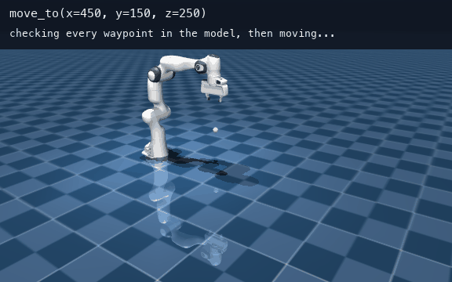

# mjguard

[](https://pypi.org/project/mjguard/)
[](https://github.com/SamKo88927/mjguard/actions/workflows/ci.yml)
[](LICENSE)

<!-- mcp-name: io.github.SamKo88927/mjguard -->

Let an LLM agent drive **any MuJoCo-modelled robot arm** over [MCP](https://modelcontextprotocol.io), with every
motion checked in the model before it runs.

Language models refuse unsafe requests in chat, then carry them out when they hold a robot's tools: refusal falls
from 73% of text requests to 18-25% once the model controls the arm
(["Refuses in Chat, Complies with Arms"](https://arxiv.org/abs/2610.14043), Sun et al., 2026). mjguard puts the check below the model, where a prompt cannot
reach it: the agent asks for a pose, mjguard plans it, checks every waypoint against the robot's own MuJoCo model,
and either moves or returns a refusal the model can act on.

```sh
uvx mjguard check panda    # first run downloads MuJoCo Menagerie (about a minute)
uvx mjguard serve panda    # MCP over stdio; or ur5e, or your own robot.toml
```

<p align="center">
  
</p>

<sub>Franka Panda from MuJoCo Menagerie with a parts bin configured as an obstacle, driven through the same executor
and guard the MCP server uses (`scripts/record_demo.py`). A move into the bin is refused and its suggestion followed;
then a straight-line descent, a grasp, a straight-line lift, and a refused move into the table.</sub>

Why the check has to live below the model, and the bugs this project's own tests found:
[docs/why-below-the-model.md](docs/why-below-the-model.md).

## What it checks

Every motion is planned into joint-space waypoints, and **every waypoint** is checked before anything moves:

| Check | Refusal code |
| --- | --- |
| Joint ranges from the model, minus a margin | `JOINT_LIMIT` |
| Contacts between moving links and the rest of the scene, from MuJoCo's own collision pipeline | `COLLISION`, `TABLE_COLLISION` |
| Distance from every moving collision geom (meshes included) and the tool point to the floor or table, with a planning margin above the hard limit | `TABLE_CLEARANCE` |
| Distance from every moving collision geom to every obstacle in the config, with the same planning margin | `OBSTACLE_CLEARANCE`, `COLLISION` |
| An optional workspace box for the tool point | `WORKSPACE` |
| IK convergence: a miss beyond 1 mm or 1.5° is a refusal, never a "close enough" plan | `UNREACHABLE` |

While the motion runs, and again after the servos settle, a monitor checks what the robot **actually** did and
halts it (`ENVELOPE_BREACH`) if the measured arm crosses a hard limit (floor or obstacle) or touches anything. Plans keep a margin
(10 mm by default) above that limit: under physics, the UR5e and Panda presets settle about 6 mm below their plan,
and a test pins that they stay above the hard limit.

## Refusals a model can use

```json
{
  "ok": false,
  "refusal": {
    "code": "UNREACHABLE",
    "message": "no joint solution reaches the target; the closest misses by 2032.0 mm and 40.7 deg",
    "suggestion": {"x_mm": 890.7, "y_mm": 125.3, "z_mm": 277.5,
                   "note": "farthest checked-safe point on the straight line toward the target (19% of the way)"}
  }
}
```

The suggestion is the farthest point toward the target that passed every check, rounded the way a model will send
it back, and re-planned deterministically, so following it (with the `tool_down` it names) is accepted. A property test sends random targets and
follows every suggestion to keep it that way.

## Built-in robots

Thirteen arms from [MuJoCo Menagerie](https://github.com/google-deepmind/mujoco_menagerie), downloaded on first use.
CI runs every one of them end to end with its own servos under gravity: reach a target, refuse one in the table and
one out of reach, stay above the hard clearance limit, follow the suggestion.

| Hobby and research | Collaborative and industrial |
| --- | --- |
| `so_arm100`, `so_arm101` (LeRobot) | `ur5e`, `ur10e` (Universal Robots) |
| `low_cost_robot_arm` | `panda`, `fr3` (Franka) |
| `piper` (AgileX) | `iiwa14` (KUKA) |
| `yam` (I2RT) | `gen3` (Kinova) |
| `z1` (Unitree) | `xarm7` (UFACTORY) |

Each preset's planning margin covers the tracking error its model's servos show in simulation (10 mm for most,
40 mm for the Z1). Grippers are configured for the Panda, SO-ARM100, SO-ARM101, low-cost arm, PiPER and YAM.

## Your own robot

Write a small TOML file next to your MJCF:

```toml
name = "my_arm"

[model]
mjcf = "scene.xml"          # or "menagerie:<name>"
floor_geom = "floor"        # a plane; clearance is measured against it
keyframe = "home"           # start and rest pose

[arm]
joints = ["joint1", "joint2", "joint3", "joint4", "joint5", "joint6"]
tcp_site = "tool"           # or tcp_body = "hand" with tcp_offset_m = [0, 0, 0.1]
tool_axis = "z"             # the axis that points out of the tool
actuators = ["a1", "a2", "a3", "a4", "a5", "a6"]   # position servos: simulate with physics; omit for kinematic

[limits]
min_clearance_mm = 20       # hard limit, enforced on the measured arm
planning_margin_mm = 10     # plans keep 30 mm
workspace_mm = { x = [-600, 600], y = [-600, 600] }
obstacle_clearance_mm = 10   # hard limit on the measured arm; plans keep 10 + planning_margin_mm

[gripper]                   # optional
joints = ["finger_left", "finger_right"]
closed = [0.0, 0.0]
open = [0.04, -0.04]
actuator = "gripper"        # optional: drive it in physics
ctrl_closed = 0.0
ctrl_open = 0.04

[[obstacles]]               # boxes, cylinders and spheres on the table; millimetres, z = height of the centre
name = "parts_bin"
shape = "box"
size_mm = [120, 160, 140]   # box: x, y, z; cylinder: diameter, height; sphere: diameter
center_mm = [300, 0, 70]
```

```sh
mjguard check robot.toml     # loads it, checks the rest pose, prints the envelope
mjguard serve robot.toml     # MCP over stdio
```

Two kinds of contact are part of a model's design rather than a collision, and mjguard treats them that way:
contacts the model already has in its rest pose (Kinova Gen3's base and shoulder hulls overlap; closed fingers touch;
a UR shoulder sits on the floor) are allowed up to the depth they have at rest, and `mjguard check` lists them; and
bodies whose relative pose depends only on gripper joints (two fingers) are not checked against each other. Fingers
against the arm, the table and obstacles are. Contacts with a configured obstacle are never allowed, at rest or
otherwise.

Links whose moving joints all spin about a vertical axis (a turret on its base) cannot change height, so they are
exempt from the clearance check; they are still collision-checked.

### Claude Code

```sh
claude mcp add ur5e -- uvx mjguard serve ur5e
```

## Tools

`get_state`, `get_limits`, `move_to(x_mm, y_mm, z_mm, tool_down=true, speed, path="joint")`,
`move_joints({name: value})`, `gripper(opening)` (when configured), `rest`, `stop`; for people and UIs also
`jog`, `jog_joint`, `execute`, `preview_sequence`, `pause`, `resume`, `save_pose`, `go_to_pose`, `list_poses`,
`delete_pose`, `discard`, `release_stop` (below).

`path="line"` makes the tool point travel a straight line, sampled every 5 mm, with IK solved point to point so the
arm cannot flip configuration mid-way; a line that crosses a singularity or leaves reach is refused, and a refusal's
suggestion says which `path` it was checked with. Resources: `mjguard://limits`, `mjguard://trace/latest`,
`mjguard://events/latest`. Millimetres and degrees; z is the height above the floor plane.

## Human-robot interaction

A web console, a phone app or a voice front end can sit on top of mjguard. None of these features is a new way to
move: every one goes through the same plan, check, follow and monitor path, and none can widen the envelope.

**Preview, then confirm.** Every motion tool takes `preview=true`. Nothing moves; the result is either the usual
refusal (with its suggestion) or `{"ok": true, "executed": false, "plan_id": ..., "expires_in_s": 60, "plan": {...}}`.
`plan` has the waypoint count, duration, lowest floor clearance and obstacle gap, start and end tool pose, and
`path_mm`, up to 50 tool positions along the path to draw as a ghost. `execute(plan_id)` runs it once, within 60 s,
and only if the measured arm is still within 0.5° (or 0.5 mm) of the plan's start (`PLAN_UNKNOWN`, `PLAN_USED`,
`PLAN_EXPIRED`, `PLAN_STALE` otherwise). The waypoints are checked again, from the measured arm, right before they run.
With `--require-confirmation` (or `[ui] require_confirmation = true`) every motion tool only previews, so nothing
moves until someone calls `execute`.

**Sequences.** A task of several motions ("pick the part and put it in the bin") is one preview and one approval.
`preview_sequence(steps, speed=0.5)` takes 1 to 10 steps, each `{"tool": ..., ...that tool's arguments}` with tool
`move_to`, `move_joints`, `gripper`, `rest` or `go_to_pose` (no `preview` flag; jogs are relative and stay single).
Each step is planned from where the step before it is predicted to end (arm joints and gripper), by the same planner
and the same checks as that tool on its own, so a sequence cannot do anything its steps could not do one by one.
Nothing moves. The result is one `plan_id` with `steps` (per step: `index`, `tool`, `arguments` and the same summary
as a single preview, with a shorter `path_mm`) and `totals` (duration, lowest clearance and obstacle gap, start and
end tool pose, final gripper opening), or a refusal for the first failing step: `details.step` is its 0-based index,
`message_human` starts 「第 3 步：」/ "Step 3:", and a suggestion carries `step` and was planned from that step's
predicted start, so it can replace the step as is. A refused sequence stores nothing.

```python
r = executor.preview_sequence(
    [
        {"tool": "move_to", "x_mm": 300, "y_mm": 100, "z_mm": 120},  # above the part
        {"tool": "move_to", "x_mm": 300, "y_mm": 100, "z_mm": 60, "path": "line"},  # down
        {"tool": "gripper", "opening": 0},  # grip
        {"tool": "move_to", "x_mm": 300, "y_mm": 100, "z_mm": 120, "path": "line"},  # up
        {"tool": "move_to", "x_mm": 250, "y_mm": -150, "z_mm": 120},  # above the bin
        {"tool": "gripper", "opening": 1},  # let go
    ]
)
executor.execute(r["plan_id"])
```

`execute(plan_id)` runs a sequence with the same one-shot, 60 s, `discard` and `STOP_LATCHED` rules as a single plan,
and step 0 must start within 0.5° (or 0.5 mm) of where the preview measured the arm. Then, before each step, it reads
the arm again:

- *Is the arm where this step starts?* A later step starts where the previous step was planned to end, and no arm
  tracks a plan exactly: under physics the measured tool point settles 1 to 18 mm from the plan, depending on the
  robot. So the tool point may be up to the config's `planning_margin_mm` (at least 0.5 mm) from that planned end.
  The margin is the tracking error a config already budgets for: plans keep it above the hard limits so the measured
  arm may be that far off and stay safe. Within it, the previous step got where it was meant to; beyond it (an arm
  that was blocked, slipped or never arrived) the route the person approved no longer describes the arm, and the
  step is refused with `PLAN_STALE` (`off_mm`, `tolerance_mm`). The tool point is compared rather than each joint
  because per-joint settle error varies much more between arms (0.01° to 5°) than tool error does. It cannot see a
  pure wrist roll; the next point covers safety either way.
- *Is the path still clear?* The step's waypoints are checked again from the measured arm, with the gap to its first
  waypoint filled in at the guard's joint step, as `resume()` does. A box put on the table after the preview refuses
  the step that would reach it.

Measured with a pick-and-place loop on every physics preset: the tolerance passes all of them at speed 0.3, and all
but two at 0.5 and 1.0. UR5e settles 12 mm off at full speed (margin 10 mm). Kinova Gen3 really does not arrive
(15 to 92 mm off at speed 0.5 and above; at 0.3 its own single moves can end over 100 mm off): exactly what the check
is for.

A refusal, breach, stop or pause halts the rest. The result has `sequence: {steps, completed, halted_at}`, one record
per step that ran (`steps`: `index`, `tool`, `ok`, `executed`) and the `refusal` with its `details.step`. `pause()`
keeps the remaining steps: `get_state` shows `paused_motion.sequence` (`step`, `steps`, `remaining_steps`), and
`resume()` re-checks the paused step from the measured arm, then runs the rest, each checked as above. A refused
resume stays paused. `stop()`, or any new motion, discards the remaining steps (`discarded_sequence_steps`).
Events: `sequence_started` (plan_id, steps, tools, duration), `step_started` / `step_finished` (`index`, `of`,
`ok`, `code`), `sequence_finished` (`ok`, `completed`, `halted_at`), and the usual motion events, which carry
`step` and `steps` while a sequence runs.

**Jog.** `jog(dx_mm, dy_mm, dz_mm)` moves the tool point in a straight line, at most 50 mm, keeping the tool's
direction (or pointing it down with `tool_down=true`). `jog_joint(joint, delta)` moves one joint by at most 10° (or
10 mm). Both are checked like any move; a refused jog's suggestion is an absolute point for `move_to`.

**Named poses.** `save_pose(name)` remembers the joints and gripper opening where the arm is now; `go_to_pose(name)`
plans and checks a move there against the envelope in force now, so a pose saved before an obstacle was added is
refused. The gripper stays as it is unless `include_gripper=true`, so going to a pose never drops what the arm
holds. `--poses poses.json` keeps them across restarts; the file is validated on load, and a pose in it is only a
target.

**Pause and resume.** `pause()` halts at the next waypoint and keeps the rest of the motion (`get_state` shows
`"paused": true`). `resume()` checks the path from where the arm is now through the remaining waypoints and
continues, or refuses with the reason and stays paused. `stop()` or any new motion discards a paused one. A new motion that replaces a paused one reports `discarded_paused_motion: true`.

**Events.** `executor.events` is an in-process bus: `motion_started`, `progress` (at most 10 Hz, with tool pose,
joints and clearance), `motion_finished`, `refused`, `stopped`, `paused`, `resumed`, `breach`, `pose_saved`,
`pose_deleted`, `stop_released`, and for sequences `sequence_started`, `step_started`, `step_finished`,
`sequence_finished`. Subscribe in Python with `events.subscribe(callback)` or `events.subscribe_queue()`; read the last
50 from `mjguard://events/latest`; or, with `--http`, stream them as server-sent events from `GET /events`
(`Last-Event-ID` or `?after=SEQ` replays recent ones). The endpoint has the same loopback-only rule and Host/Origin
checks as the MCP endpoint; serve the UI from the same origin or proxy it. Callback subscribers run on their own thread, never the arm's, so a slow UI cannot delay a stop.

**Messages for people.** Every refusal keeps `message` (English, detailed, for models) and adds `message_human`, a
short sentence in `--lang en` or `--lang zh-TW` (`[ui] lang`), e.g. 「會太靠近桌面（還差 12 mm），已停止規劃」.
Suggestions get a `human` sentence too.

**Not authorization.** Preview-then-confirm and pause are protocol steps for an honest client. Anything that can
reach the server can call `execute` or `resume`. If people and agents share one server, put authentication in front
of it; the envelope itself never changes either way.

**For a UI's buttons.** `discard(plan_id)` when a person rejects a preview, so it can never run. An e-stop button
calls `stop(latch=true)`: nothing moves until `release_stop()` (`--latch-stop` makes latching the default); every client
sees the `stopped` and `stop_released` events. SSE event ids are `BOOT:SEQ`, so a client that reconnects after a
server restart replays from the start instead of missing events.

```sh
mjguard serve panda --http --require-confirmation --lang zh-TW --poses poses.json
```

```js
// A console: show the ghost path, ask the person, then run it, and follow along.
const events = new EventSource("/events");
events.addEventListener("progress", (e) => drawArm(JSON.parse(e.data).state));
const preview = await call("move_to", { x_mm: 450, y_mm: 100, z_mm: 250 });
if (!preview.ok) showMessage(preview.refusal.message_human);
else if (await confirm(drawGhost(preview.plan.path_mm))) await call("execute", { plan_id: preview.plan_id });
```

## Real hardware

mjguard drives a `Transport`: anything that can report joint positions and follow a list of checked waypoints. It
ships the MuJoCo simulator transport. A real arm needs a transport for its driver; the guard, the monitor and the
MCP surface stay the same. [roarm-mcp](https://github.com/SamKo88927/roarm-mcp) is the RoArm-M3 application this
library was extracted from.

`stop()` and `pause()` are software stops. On real hardware a physical e-stop is the only real emergency stop.

## Limits of the method

- The check is only as good as the model. Objects that are not in the MJCF scene are invisible to it.
- Joint-space straight lines between waypoints are checked at a fixed spacing (3° by default), not continuously.
- Dynamics (speed, torque, payload) are not checked; the envelope is geometric.

## Development

```sh
uv sync
uv run ruff check . && uv run ruff format --check . && uv run pyright && uv run pytest -q
```

## License

Apache-2.0. Robot models come from [MuJoCo Menagerie](https://github.com/google-deepmind/mujoco_menagerie) under
their own licenses and are downloaded at runtime, not redistributed.
